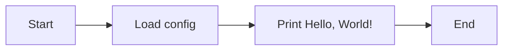
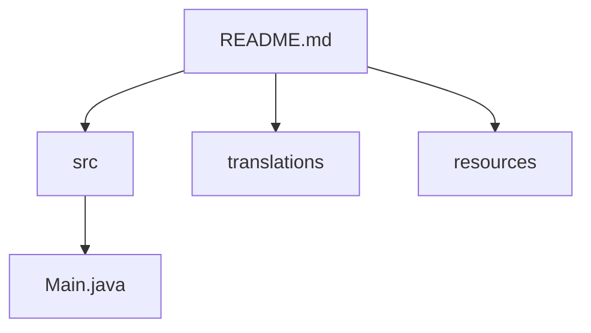

# Hello, World! — Пример привлекательного README

> Учебный проект, демонстрирующий оформление документации в **Markdown** с использованием диаграмм *Mermaid*, ссылок, таблиц и примеров кода.

---

## Навигация по проекту
- [Исходный код](./src/)
- [Переводы](./translations/)
- [Ресурсы](./resources/)
- [Внешний репозиторий с идеями](https://github.com/unhappychoice/gittype)

## Навигация по документу
- [О проекте](#о-проекте)
- [Цели](#цели)
- [Структура](#структура)
- [Пример кода (Java)](#пример-кода-java)
- [Диаграммы Mermaid](#диаграммы-mermaid)
- [Список задач](#список-задач)
- [Документы](#документы)

---

## О проекте
Этот проект — **минимальный** шаблон `Hello, World!`, созданный для практики работы с `Git`, *Markdown* и ~~хаотичной~~ качественной документацией.  
Он показывает, как сделать README **понятным**, _структурированным_ и визуально привлекательным.

> "Хорошая документация — это часть продукта, а не дополнение к нему."

---

## Цели
1. Освоить базовую разметку Markdown.
2. Научиться добавлять диаграммы Mermaid.
3. Поддерживать порядок в репозитории и ссылках.

## Структура
- `src/` — исходный код
  - `Main.java`
- `translations/` — переводы документации
  - `README.ru.md`
  - `README.en.md`
- `resources/` — изображения и прочие материалы


## Пример кода (Java)
```java
public class Main {
    public static void main(String[] args) {
        String message = "Hello, World!";
        System.out.println(message);
    }
}
```

## Диаграммы Mermaid

### Поток выполнения


### Компоненты проекта


## Список задач
- [x] Создать структуру проекта
- [x] Добавить README с навигацией
- [x] Добавить пример кода
- [x] Добавить Mermaid-диаграммы
- [ ] Добавить CI-проверку Markdown

## Документы
1. [src/Main.java](./src/Main.java)
2. [translations/README.ru.md](./translations/README.ru.md)
3. [translations/README.en.md](./translations/README.en.md)
4. [resources/notes.md](./resources/notes.md)

---
*Если вы нашли ошибку — создайте issue или сообщите автору.*
