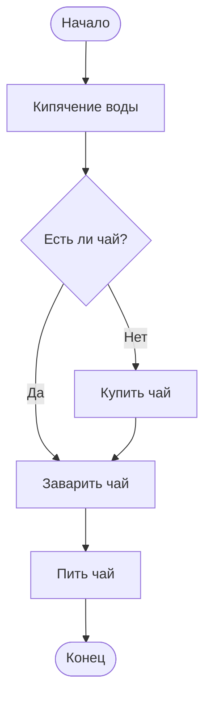
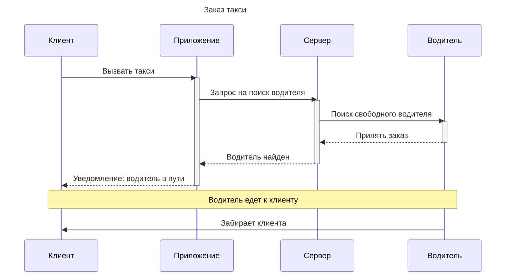
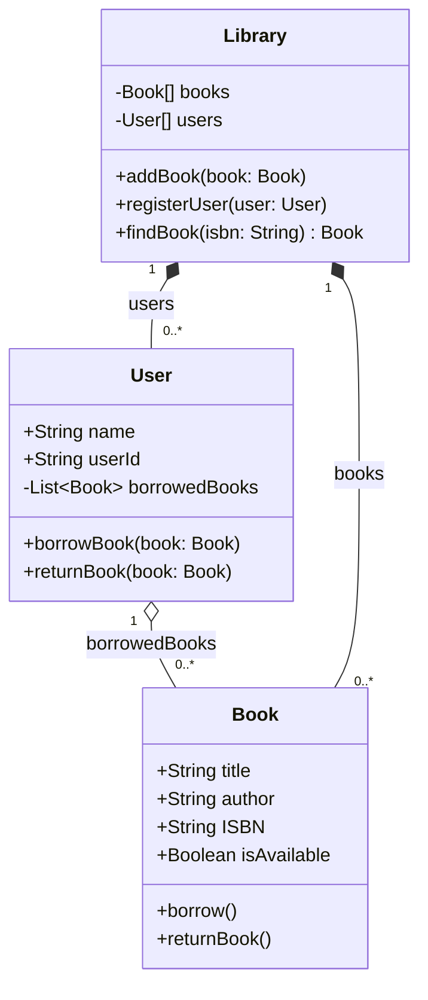
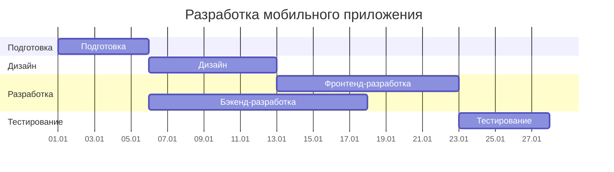
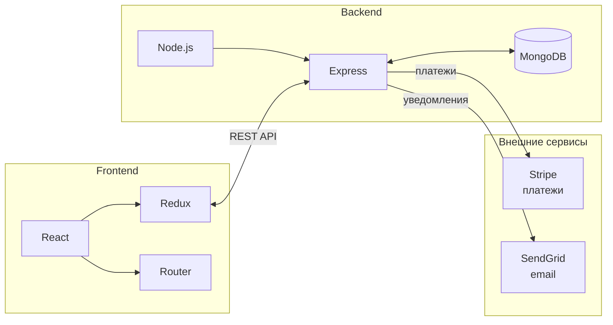
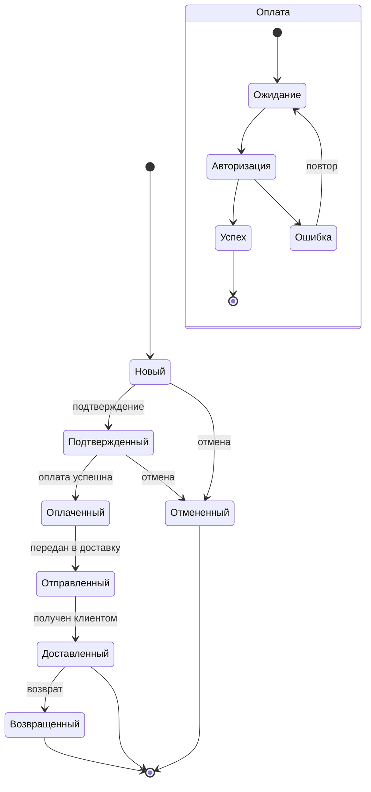
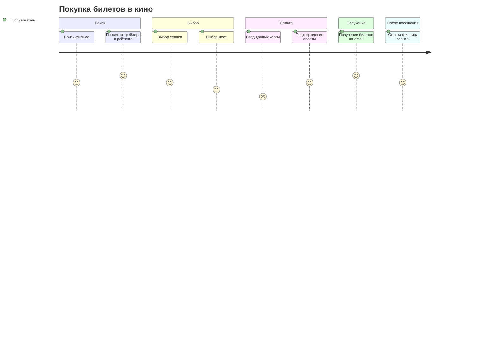
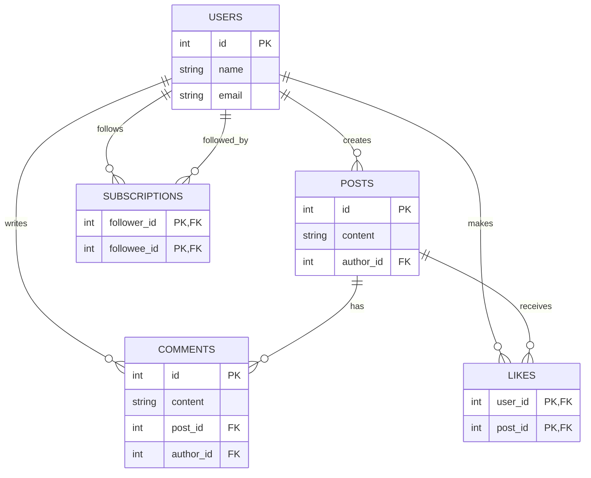
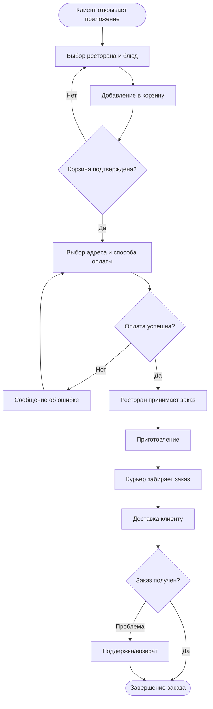
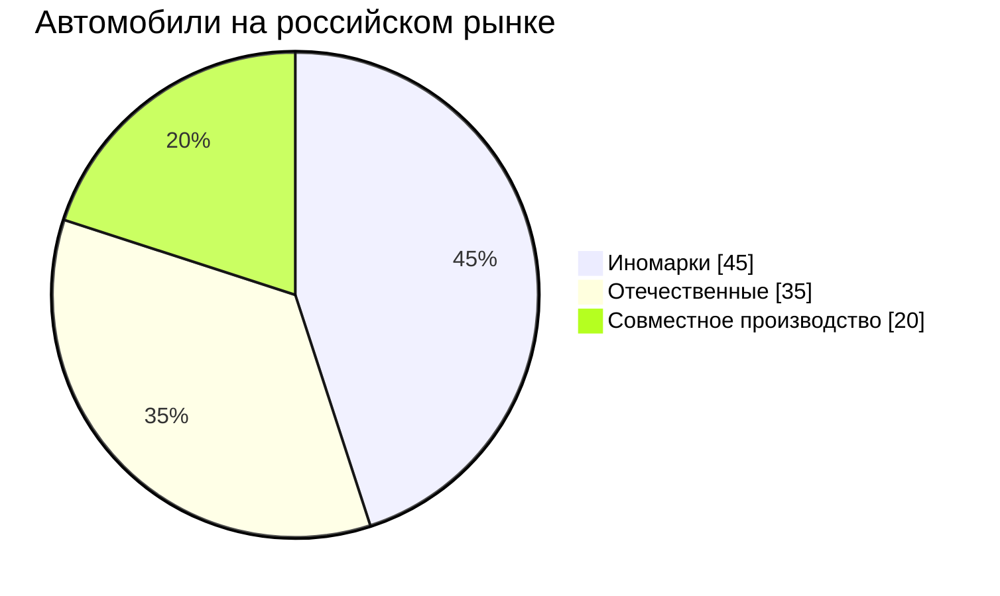

# Практические задания по Mermaid

В этом документе собраны решения заданий по Mermaid.

## Уровень 1: Начальный

### Задание 1.1: Простая блок-схема "Приготовление чая"

### Задание 1.2: Диаграмма последовательности "Заказ такси"

## Уровень 2: Средний

### Задание 2.1: Диаграмма классов "Библиотечная система"

### Задание 2.2: Диаграмма Ганта "Разработка мобильного приложения"

## Уровень 3: Продвинутый

### Задание 3.1: Архитектура веб-приложения

### Задание 3.2: Диаграмма состояний "Заказ в интернет-магазине"

## Уровень 4: Экспертный

### Задание 4.1: User Journey Map "Покупка билетов в кино"

### Задание 4.2: ER-диаграмма "Социальная сеть"

### Задание 5: Блок-схема процесса заказа "Сервис доставки еды"

### Задание 6: Круговая диаграмма "Автомобили на российском рынке"

---
*Диаграммы подготовлены в рамках практического задания.*
